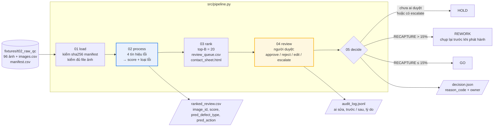
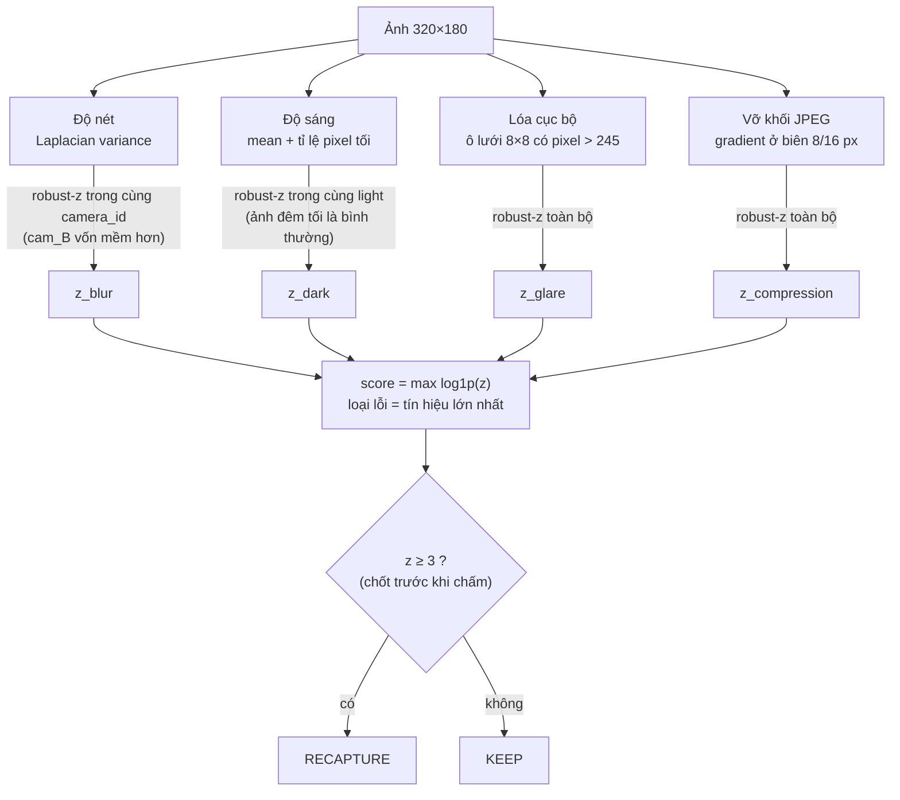
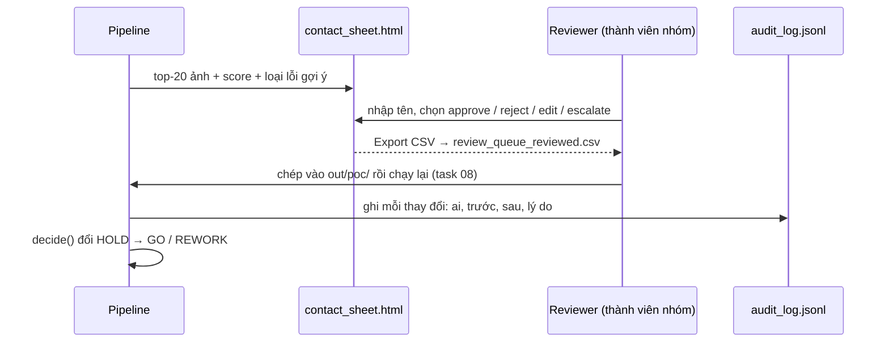

# G03 · T02 Raw QC Triage — Sơ đồ pipeline

Một lệnh (`python -m src.main --config configs/lab.yaml --track t02 --offline --seed 42`) chạy 5 bước. Bước 02 là phần thuật toán của nhóm; bước 04 là chỗ con người duyệt và ký.

## 1. Luồng 5 bước

## 2. Bước 02: bốn tín hiệu, mỗi tín hiệu so trong "nhóm công bằng"

Robust-z = (giá trị − trung vị) / (1,4826 × MAD), tính trong từng nhóm; nhóm < 6 ảnh dùng độ phân tán toàn bộ. Không dùng nhãn ở bất kỳ bước nào.

## 3. Vòng human-in-the-loop

## 4. Baseline so sánh

| | Baseline (`src/baselines/t02_laplacian.py`) | PoC (`src/pipeline.py`) |
|---|---|---|
| Tín hiệu | 1: độ nét Laplacian toàn ảnh | 4: mờ, tối, lóa cục bộ, vỡ khối |
| Chuẩn hoá theo slice | Không | Có: camera cho độ nét, light cho độ sáng |
| Bắt được | Chủ yếu ảnh mờ | Mờ, tối, lóa, vỡ khối |
| Pool / B / seed | 40 ảnh eval / 20 / 42 | 40 ảnh eval / 20 / 42 |
